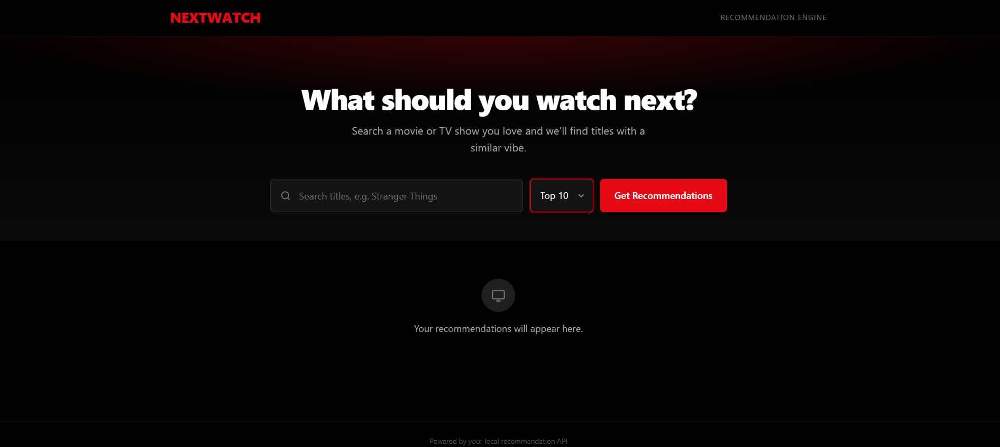
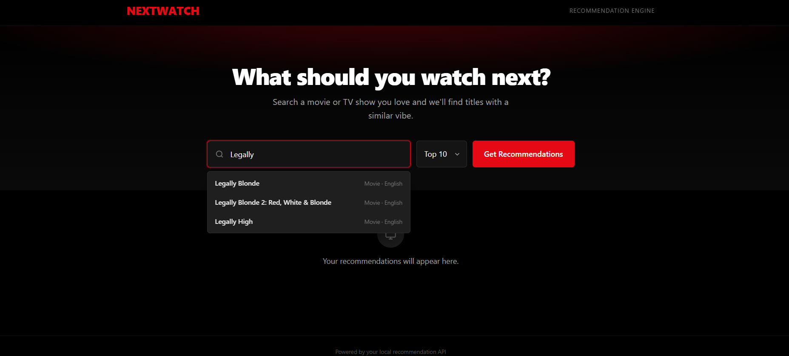
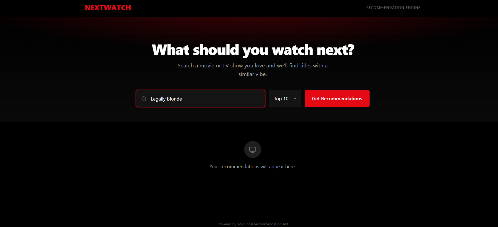
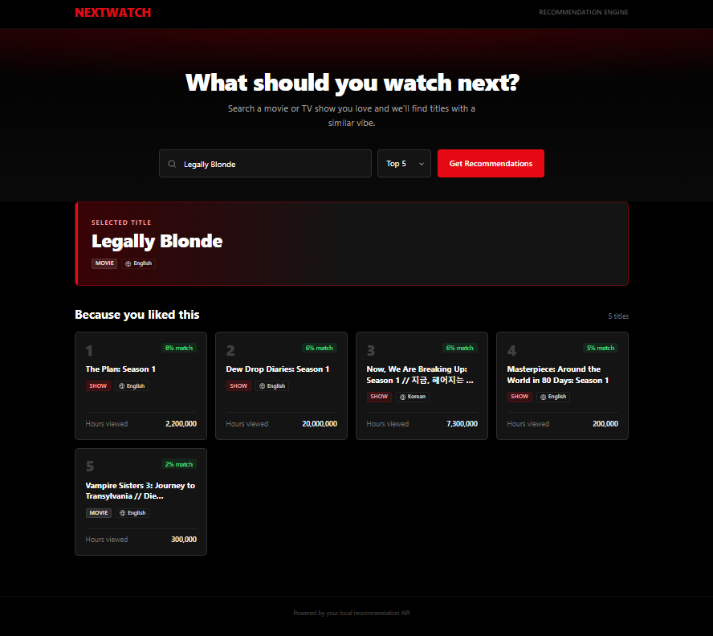

# 🎬 NextWatch — Netflix Recommendation System (Flask + TensorFlow)

An end-to-end content recommendation web application built with **TensorFlow/Keras** and **Flask**. Users can search across **19,158 movies and TV shows**, view live autocomplete suggestions, and generate personalized top-$K$ recommendations based on content embeddings, language, and content type.

---

## ✨ Features

* **Deep Learning Recommendation Engine:** Uses a trained Keras neural network (`Netflix_Recommendation.h5`) to score and rank similar titles across the entire catalog.
* **Interactive Dark-Mode UI:** Clean Netflix-inspired web interface (`NextWatch`) served directly by Flask with dynamic `Top K` selection (5, 10, or 15 recommendations).
* **Live Autocomplete Search:** Real-time title matching with exact and partial search fallback.
* **RESTful JSON API:** Supports both `GET` and `POST` requests for easy integration with external frontends or mobile apps.

---

## 🛠️ Tech Stack

* **Machine Learning:** TensorFlow / Keras, NumPy, Pandas
* **Backend:** Python, Flask, Flask-CORS
* **Frontend:** HTML5, Tailwind CSS, Vanilla JavaScript

---

## 📂 Project Structure

```text
Netflix_Flask_API/
├── app.py                              # Flask server and REST API endpoints
├── requirements.txt                    # Python dependencies
├── README.md                           # Project documentation
├── artifacts/
│   ├── Netflix_Recommendation.h5       # Trained Keras recommendation model
│   └── netflix_data.pkl                # Preprocessed catalog metadata (19,158 titles)
└── templates/
    └── index.html                      # NextWatch frontend UI
```

---

## 🚀 Getting Started

### 1. Clone the Repository
```bash
git clone https://github.com
cd netflix-recommendation-system
```

### 2. Create and Activate a Virtual Environment
**Windows:**
```bash
python -m venv venv
venv\Scripts\activate
```

**macOS / Linux:**
```bash
python3 -m venv venv
source venv/bin/activate
```

### 3. Install Dependencies
```bash
pip install -r requirements.txt
```

### 4. Run the Application
```bash
python app.py
```
Open your browser and navigate to **`http://localhost:5000`**.

---

## 🔌 API Endpoints

| Method | Endpoint | Description | Example |
| :--- | :--- | :--- | :--- |
| `GET` | `/` | Renders the NextWatch web interface | `http://localhost:5000/` |
| `GET` | `/health` | Checks server status and loaded dataset count | `http://localhost:5000/health` |
| `GET` | `/titles` | Searches titles matching query `q` | `http://localhost:5000/titles?q=Wednesday` |
| `GET` | `/recommend` | Returns `top_k` recommendations for a `title` | `http://localhost:5000/recommend?title=Wednesday&top_k=5` |
| `POST` | `/recommend` | Accepts JSON `{"title": "Wednesday", "top_k": 5}` | `http://localhost:5000/recommend` |

---

## 📸 Screenshots







